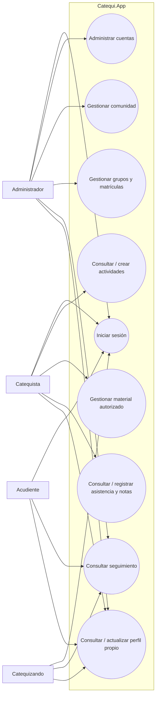
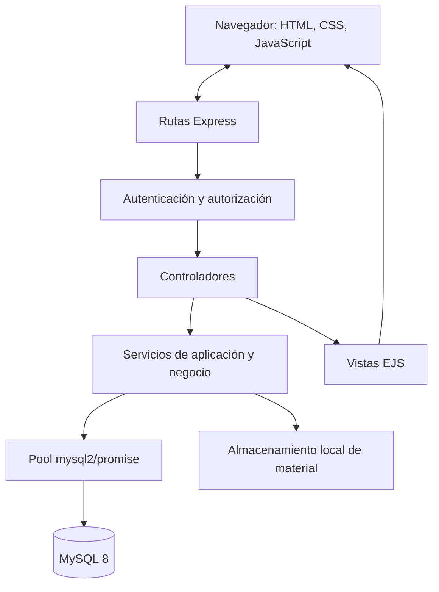
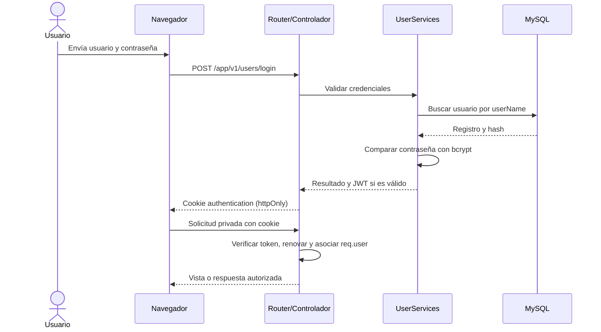
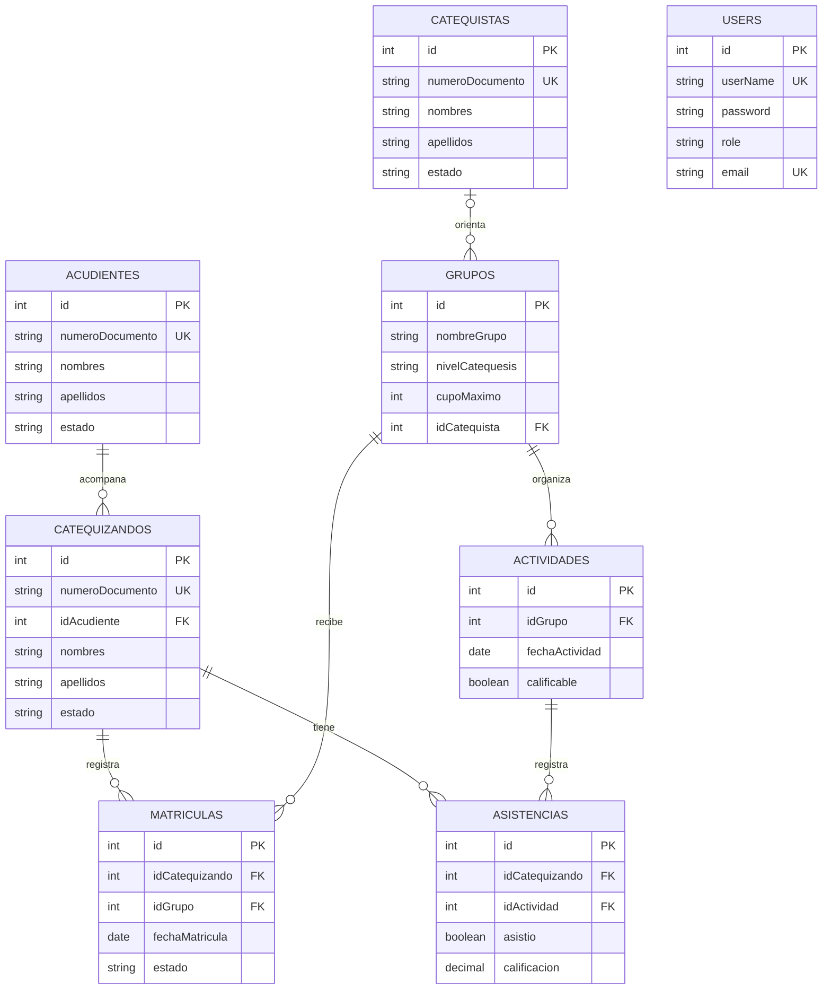

# Catequi.App
## Documentación académica y técnica del proyecto prototipo

**Documento base para proyecto de formación técnica del SENA**

> **Estado del documento:** borrador integral para revisión del aprendiz, instructor y organización beneficiaria. Describe las capacidades que se observan en el repositorio y propone el contenido académico que aún debe validarse con evidencias del contexto real. Los campos entre corchetes requieren diligenciamiento. Las propuestas no deben presentarse como actividades realizadas ni como resultados medidos hasta contar con soportes.

| Dato de identificación | Información |
|---|---|
| Título del prototipo | Catequi.App: sistema web para la gestión y seguimiento del proceso de catequesis |
| Aprendiz(es) | [Nombres y apellidos] |
| Programa de formación | [Nombre oficial del programa técnico SENA] |
| Ficha | [Número de ficha] |
| Centro de formación | [Centro de formación] |
| Instructor(a) | [Nombre del instructor] |
| Organización beneficiaria | [Parroquia, comunidad u organización] |
| Municipio y departamento | [Lugar] |
| Fecha | [Mes y año de entrega] |
| Versión del documento | 1.0 — borrador para validación |

---

## Control de precisión y alcance de esta documentación

Esta memoria se elaboró contrastando la descripción suministrada para el proyecto con el código, el esquema SQL y la guía de instalación disponibles en el repositorio. Por lo tanto:

- Se documentan como **implementadas según el código** las capacidades respaldadas por rutas, controladores, servicios, vistas o tablas.
- Se identifican como **propuestas** las actividades de investigación, entrevistas, pruebas, resultados de impacto y entregables académicos para los cuales no se encontraron evidencias en el repositorio.
- No se afirma que la aplicación cumpla integralmente una ley, estándar de seguridad o competencia SENA solo por mencionarlos como marco de referencia.
- No se incluyen datos personales, credenciales reales, mediciones de consumo de papel ni resultados de pruebas no suministrados.
- Los diagramas son representaciones de análisis basadas en el sistema observado; deben revisarse con el instructor y los usuarios antes de considerarse diseño aprobado.

## Tabla de contenido

1. Resumen
2. Introducción
3. Identificación y título del proyecto
4. Planteamiento del problema
5. Justificación
6. Objetivos
7. Alcance y delimitaciones
8. Actores y roles
9. Marco de referencia
10. Metodología
11. Planificación
12. Especificación de requisitos (E.R.S.)
13. Diseño de la solución
14. Arquitectura e implementación
15. Modelo de datos
16. Seguridad, privacidad y tratamiento de información
17. Instalación, operación y manual de usuario
18. Plan de pruebas y criterios de aceptación
19. Estimación de recursos y costos
20. Resultados, impacto y evaluación
21. Riesgos y acciones de tratamiento
22. Conclusiones
23. Recomendaciones y trabajo futuro
24. Bibliografía y fuentes
25. Competencias y resultados de aprendizaje SENA
26. Anexos y evidencias por completar

---

## 1. Resumen

Catequi.App es un prototipo de aplicación web orientado a apoyar la gestión de información del proceso de catequesis. La solución organiza datos de usuarios, catequistas, acudientes, catequizandos, grupos, matrículas, actividades y asistencias. También ofrece vistas web diferenciadas por rol y funciones para registrar asistencia y calificaciones en actividades calificables.

El sistema está construido con Node.js y Express en el servidor, plantillas EJS, CSS y JavaScript en la interfaz, y MySQL para la persistencia. Las contraseñas se almacenan como hashes generados con bcryptjs; los tokens JWT se transportan en una cookie `httpOnly`. Las operaciones se separan en rutas, controladores, servicios y acceso a datos.

El prototipo contempla cuatro roles: administrador, catequista, acudiente y catequizando. El administrador gestiona cuentas y registros generales; el catequista trabaja con actividades y seguimiento de sus grupos asignados; acudientes y catequizandos disponen de consultas de seguimiento de solo lectura sujetas a las relaciones registradas.

La documentación presenta la solución y un plan de validación académica. La medición del problema, las pruebas formales, los resultados con usuarios, los costos, la aprobación institucional y algunas decisiones de despliegue deben completarse con evidencias reales antes de la sustentación.

**Palabras clave:** catequesis, gestión académica, aplicación web, MySQL, control de acceso por roles, asistencia.

## 2. Introducción

La organización de un proceso de catequesis requiere administrar información de participantes, acudientes, catequistas, grupos, matrículas y actividades. Cuando los datos se encuentran distribuidos entre documentos físicos y archivos independientes, puede aumentar el esfuerzo necesario para mantenerlos actualizados, consultarlos y consolidar el seguimiento.

Catequi.App propone una herramienta web para centralizar esos registros y facilitar su consulta según el perfil de cada usuario. El prototipo incluye autenticación, panel de inicio, gestión de módulos de formación, administración de catequistas y cuentas, además de una cuadrícula de asistencia por grupo.

Este documento describe la necesidad que motiva la propuesta, sus objetivos, actores, requisitos, arquitectura, modelo de datos, operación, pruebas por realizar y recursos. No reemplaza la validación del proceso de la parroquia beneficiaria: la caracterización del problema, la aprobación de requisitos y la medición del impacto deben sustentarse con entrevistas, observación, actas y resultados verificables.

## 3. Identificación y título del proyecto

### 3.1 Nombre

**Catequi.App** (también denominado **CatequiApp** en la interfaz).

### 3.2 Título del prototipo

**Catequi.App: sistema web para la gestión y seguimiento del proceso de catequesis.**

### 3.3 Tipo de proyecto

Prototipo de software web con arquitectura cliente-servidor, interfaz renderizada en el servidor y persistencia relacional en MySQL.

## 4. Planteamiento del problema

### 4.1 Contexto y situación por validar

La descripción inicial del proyecto señala que algunas tareas de catequesis se realizan con formularios impresos, carpetas físicas y hojas de cálculo. En ese escenario, la información de personas, grupos, matrículas y encuentros puede estar distribuida en varios medios, lo que dificulta tener una fuente única y mantener consistentes los datos.

Esta descripción es una **hipótesis de trabajo**, no una medición documentada del lugar beneficiario. Antes de presentarla como diagnóstico definitivo se recomienda levantar información en la parroquia: qué registros se utilizan, quién los mantiene, cuántos participantes y grupos se atienden, con qué frecuencia se consultan los datos, qué problemas ocurren y cuánto papel se consume por período.

### 4.2 Necesidad identificada

Se requiere una herramienta que permita centralizar los registros principales del proceso catequético, controlar el acceso a la información por rol, relacionar catequizandos con acudientes y grupos, y apoyar el registro y la consulta de actividades, asistencia y calificaciones.

### 4.3 Pregunta problema

**¿Cómo puede una aplicación web con control de acceso por roles apoyar la organización y el seguimiento de la información de catequistas, acudientes, catequizandos, grupos, matrículas y actividades de una comunidad parroquial?**

La pregunta debe ajustarse cuando se confirme la población, la parroquia y el proceso concreto que será objeto de observación.

### 4.4 Causas, efectos y situación deseada

| Elemento | Descripción preliminar, pendiente de validación |
|---|---|
| Causas posibles | Registros distribuidos; actualización manual; falta de una herramienta común; procesos de consulta no estandarizados. |
| Problema central | Dificultad para administrar de manera centralizada la información y el seguimiento del proceso de catequesis. |
| Efectos posibles | Duplicidad o desactualización; mayor esfuerzo de búsqueda; consolidación manual de reportes; dependencia de archivos impresos o aislados. |
| Situación deseada | Información organizada en una aplicación con acceso controlado, relaciones entre entidades y consultas de seguimiento según los permisos. |

Los efectos descritos deben comprobarse mediante el análisis del proceso actual; no se presuponen como resultados ya medidos.

## 5. Justificación

### 5.1 Pertinencia

El proyecto es pertinente porque aborda un proceso de gestión comunitaria que requiere administrar datos relacionados entre sí y consultar información de acuerdo con responsabilidades diferentes. Una aplicación centralizada puede facilitar el mantenimiento de registros y el acceso oportuno a información de grupos, participantes, actividades y asistencia.

### 5.2 Impacto esperado

Si la organización beneficiaria valida la necesidad y adopta la herramienta, se espera:

- Reducir la dispersión de la información operativa.
- Facilitar la consulta de matrículas, grupos y actividades.
- Apoyar el registro uniforme de asistencia y calificaciones.
- Diferenciar las capacidades disponibles para administración, catequistas, acudientes y catequizandos.
- Explorar una reducción del uso de papel, cuya magnitud deberá medirse antes y después de la adopción.

Estos son beneficios esperados, no resultados comprobados. Para afirmar un impacto se debe definir una línea base, un período de observación e indicadores.

### 5.3 Viabilidad técnica preliminar

El prototipo utiliza tecnologías disponibles para desarrollo web —Node.js, Express, EJS, JavaScript, CSS, MySQL y Docker Compose— y cuenta con scripts de inicialización de base de datos. El entorno de ejecución, los recursos de alojamiento y el soporte operativo de la parroquia deben confirmarse.

### 5.4 Viabilidad social y ética

El sistema trata datos identificativos y puede almacenar información relacionada con menores de edad. Su uso real requiere autorización de la organización, definición de responsables y finalidades, acceso limitado, reglas de conservación, copias de seguridad y procedimientos para atender solicitudes de titulares o representantes. La implementación tecnológica por sí sola no demuestra cumplimiento jurídico.

## 6. Objetivos

### 6.1 Objetivo general

Desarrollar y documentar un prototipo de aplicación web que apoye la gestión y el seguimiento del proceso de catequesis mediante la centralización de información de sus participantes, grupos, matrículas y actividades, con acceso controlado según los roles definidos.

### 6.2 Objetivos específicos

1. Caracterizar, mediante entrevistas y observación acordadas con la organización beneficiaria, el proceso actual de administración de catequesis y sus necesidades de información.
2. Definir los requisitos funcionales y no funcionales y diseñar el modelo de datos y los diagramas necesarios para representar la solución.
3. Implementar los servicios y endpoints del prototipo con Node.js, Express y MySQL, aplicando separación por capas y autenticación basada en JWT.
4. Construir vistas web en EJS, CSS y JavaScript para consultar y administrar los módulos autorizados.
5. Implementar las validaciones disponibles para relaciones, roles y calificaciones, y contrastar las brechas funcionales con los requisitos aprobados.
6. Diseñar y ejecutar pruebas de aceptación, integración y servicios; registrar resultados y corregir defectos encontrados.
7. Elaborar la documentación técnica y un manual de usuario que permita instalar, configurar y utilizar el prototipo.

> Los objetivos expresan el trabajo esperado. La memoria final debe diferenciar objetivos propuestos, actividades ejecutadas y resultados con evidencia.

## 7. Alcance y delimitaciones

### 7.1 Incluido en el prototipo observado

- Inicio de sesión y autenticación con JWT en cookie.
- Gestión de cuentas de usuario por parte de usuarios con rol administrador.
- Perfil del usuario autenticado y actualización de sus datos de perfil.
- Gestión de catequistas.
- Módulos de acudientes, catequizandos, grupos, matrículas, actividades y asistencias.
- Relaciones de catequizandos con acudientes, grupos con catequistas, matrículas con participantes y grupos, actividades con grupos y asistencias con participantes y actividades.
- Carga y descarga autenticada de materiales de actividad en formatos PDF, DOC, DOCX, XLS y XLSX, con límite de carga configurado en el servicio.
- Cuadrícula para consultar y guardar asistencia y calificaciones por grupo.
- Restricciones de acceso según rol y pertenencia del catequista a un grupo.
- Interfaz web en español con panel de inicio y navegación por rol.

### 7.2 Fuera del alcance demostrado

- Registro público de usuarios: se encuentra deshabilitado; la vista `/register` redirige al inicio.
- Aplicación móvil nativa.
- Integración con sistemas parroquiales, plataformas de pago, correo o mensajería.
- Notificaciones automáticas.
- Analítica predictiva.
- Exportación descargable de reportes: no se encontró una función implementada de generación de archivos de reporte. La descarga de materiales de actividad no equivale a exportar reportes.
- Actualización de datos en tiempo real mediante WebSocket o mecanismo equivalente. La interfaz consulta los endpoints; no debe anunciarse como tiempo real sin evidencia de actualización continua.
- Capacidad de matrícula que rechace automáticamente inscripciones por superar `cupoMaximo`: el campo existe y se valida como dato numérico, pero no se verificó una regla de conteo y bloqueo de cupos en el servicio.
- Pruebas automatizadas listas para ejecución: el script `test` de `package.json` informa que no hay pruebas configuradas.

### 7.3 Usuarios y entorno objetivo

El entorno previsto es un navegador web actual en un computador conectado a la red donde esté desplegada la aplicación. La configuración local documentada utiliza Node.js/npm y una base MySQL 8 en Docker Compose. La disponibilidad desde internet, copias de seguridad y endurecimiento de producción son decisiones pendientes.

## 8. Actores y roles

| Actor | Necesidad | Capacidades del prototipo |
|---|---|---|
| Administrador | Administrar personas, cuentas y organización del proceso. | Gestiona cuentas, catequistas, acudientes, catequizandos, grupos y matrículas. Consulta actividades y registros de asistencia según los permisos codificados. No tiene habilitadas las escrituras de actividades ni de asistencia. |
| Catequista | Acompañar los grupos que tiene asignados. | Consulta actividades y registros de asistencia de sus grupos; puede crear actividades y cargar material para su grupo; registra asistencia y calificaciones desde la cuadrícula del grupo asignado. No se observa permiso de edición o eliminación de actividades por este rol. |
| Acudiente | Consultar información de los catequizandos asociados. | Acceso de lectura a la ficha y al seguimiento permitido por las relaciones registradas, así como a materiales autorizados. No administra registros. |
| Catequizando | Consultar su proceso formativo. | Acceso de lectura a la información y seguimiento disponibles para su rol. No administra registros. |

Los permisos se vuelven a verificar en los endpoints; ocultar botones en la interfaz no es el único control. La aplicación consulta el rol vigente en la base de datos mediante los middleware de autorización.

### 8.1 Matriz resumida de permisos

La matriz siguiente resume las reglas observadas. “Lectura” indica una capacidad de consulta, no necesariamente acceso a todos los registros del sistema.

| Funcionalidad | Administrador | Catequista | Acudiente | Catequizando |
|---|---:|---:|---:|---:|
| Administrar cuentas | Sí | No | No | No |
| Administrar catequistas | Sí | No | No | No |
| Administrar acudientes, catequizandos, grupos y matrículas | Sí | No | No | No |
| Consultar actividades | Sí | Sí, de sus grupos | Lectura autorizada | Lectura autorizada |
| Crear actividad/cargar material | No | Sí, para grupo asignado | No | No |
| Actualizar o eliminar actividad | No | No | No | No |
| Consultar asistencias/reportes | Lectura permitida | Sí, en su ámbito | Lectura autorizada | Lectura autorizada |
| Registrar asistencia/calificación | No | Sí, en cuadrícula de grupo asignado | No | No |
| Editar perfil propio | Sí | Sí | Sí | Sí |

Los límites concretos de lectura de acudientes y catequizandos dependen de las asociaciones guardadas. Se deben validar con cuentas de prueba de cada rol y revisar la respuesta de los endpoints antes de la puesta en producción.

## 9. Marco de referencia

### 9.1 Marco conceptual

- **Catequesis parroquial:** proceso de formación y acompañamiento que articula participantes, responsables, grupos, encuentros y recursos pedagógicos. La caracterización concreta debe ajustarse a las orientaciones de la diócesis y de la organización beneficiaria.
- **Sistema de información:** conjunto de personas, procesos, datos y componentes tecnológicos que captura, almacena y presenta información para apoyar operaciones.
- **Aplicación web:** software al que se accede mediante navegador y que intercambia solicitudes y respuestas entre cliente y servidor.
- **Arquitectura por capas / MVC:** organización de responsabilidades para separar rutas, controladores, servicios, persistencia y vistas.
- **Base de datos relacional:** estructura que organiza registros en tablas y establece relaciones mediante claves primarias y foráneas.
- **Autenticación y autorización:** la autenticación verifica la identidad; la autorización determina qué acciones puede realizar esa identidad.

### 9.2 Marco tecnológico

| Tecnología | Uso en el prototipo |
|---|---|
| Node.js | Entorno de ejecución del servidor JavaScript. |
| Express 4 | Framework HTTP para aplicación, middleware y rutas. |
| EJS | Plantillas HTML renderizadas desde el servidor. |
| JavaScript, HTML y CSS | Interacciones y presentación de la interfaz. |
| MySQL 8 | Persistencia relacional. |
| `mysql2/promise` | Pool de conexiones y consultas asíncronas. |
| JWT y `passport-jwt` | Dependencias y utilidades relacionadas con autenticación; el middleware observado verifica JWT directamente. |
| `bcryptjs` | Hash y comparación de contraseñas. |
| `@hapi/boom` | Errores HTTP estructurados. |
| Docker Compose | Orquestación local de MySQL y phpMyAdmin. |

### 9.3 Referentes de ingeniería, seguridad y sostenibilidad

La bibliografía propuesta por el aprendiz incluye Pressman y Sommerville para ingeniería de software; Fowler para patrones de arquitectura; OWASP Top 10 como referencia de riesgos de aplicaciones web; y el ODS 12 como contexto de consumo responsable. Estos referentes ayudan a estructurar el análisis, pero su mención no constituye una certificación ni evidencia de cumplimiento.

### 9.4 Referentes legales colombianos

Se proponen como referencias la Ley 1581 de 2012, relacionada con protección de datos personales, y la Ley 1098 de 2006, relacionada con infancia y adolescencia. Antes de cualquier operación real se recomienda que la organización responsable revise la aplicabilidad, obligaciones, autorizaciones, avisos de privacidad, tratamiento de datos de menores, retención y atención de derechos con asesoría competente. Esta memoria no constituye concepto jurídico ni declara cumplimiento legal.

## 10. Metodología

### 10.1 Enfoque propuesto

Se propone un ciclo **iterativo e incremental**, apropiado para construir módulos pequeños, revisarlos con usuarios y ajustar requisitos en función de observaciones. Esta metodología es una recomendación para formalizar el proyecto; se debe confirmar con el instructor y documentar lo efectivamente realizado.

### 10.2 Fases de trabajo

1. **Descubrimiento:** identificar actores, proceso actual, documentos, problemas y restricciones; levantar evidencias autorizadas.
2. **Análisis:** redactar requisitos, reglas de negocio, casos de uso y criterios de aceptación; validar prioridades con la organización.
3. **Diseño:** definir modelo relacional, componentes, navegación, flujos y prototipos de interfaz.
4. **Construcción incremental:** implementar autenticación y cuentas; después registros comunitarios y organización de grupos; finalmente actividades y seguimiento.
5. **Verificación:** ejecutar pruebas unitarias/de servicios, integración, seguridad básica y aceptación de usuario; registrar resultados y defectos.
6. **Despliegue de prueba y transferencia:** preparar entorno, datos de prueba, guía de instalación, manual y capacitación.
7. **Evaluación:** comparar criterios e indicadores iniciales con resultados observados y formular mejoras.

### 10.3 Técnicas e instrumentos propuestos

- Entrevista semiestructurada a coordinación, catequistas y personal administrativo.
- Observación del flujo actual, con autorización y sin fotografiar ni copiar datos personales innecesarios.
- Inventario de formatos y campos actualmente utilizados.
- Matriz de requisitos y trazabilidad.
- Casos de prueba y acta de aceptación.
- Encuesta breve de usabilidad, únicamente si el instructor y la organización autorizan su aplicación.

## 11. Planificación

El siguiente cronograma es una **plantilla de planificación**, no un registro histórico. Debe ajustarse a las fechas, disponibilidad de usuarios y duración de la etapa formativa.

| Fase propuesta | Actividades principales | Entregable verificable | Duración estimada |
|---|---|---|---:|
| 1. Inicio y diagnóstico | Acordar alcance; entrevistas; observación; línea base. | Acta de inicio, diagnóstico y mapa del proceso. | 1 semana |
| 2. Requisitos | Identificar actores; priorizar RF/RNF; validar criterios. | E.R.S. aprobada y matriz de trazabilidad. | 1 semana |
| 3. Diseño | Modelo de datos; casos de uso; arquitectura; prototipos. | Diagramas revisados y diccionario de datos. | 1 semana |
| 4. Construcción I | Autenticación, cuentas, perfiles y catequistas. | Incremento demostrable con casos de prueba. | 2 semanas |
| 5. Construcción II | Comunidad, grupos, matrículas, actividades y asistencia. | Incremento integrado y evidencia funcional. | 2 semanas |
| 6. Pruebas y correcciones | Integración, permisos, validaciones, accesibilidad básica. | Informe de pruebas, defectos y correcciones. | 1 semana |
| 7. Documentación y transferencia | Manuales, despliegue de prueba, capacitación y cierre. | Manual, acta de aceptación y sustentación. | 1 semana |

### 11.1 Hitos sugeridos

- H1: alcance y diagnóstico aprobados.
- H2: requisitos y modelo de datos validados.
- H3: incremento funcional instalado en entorno de prueba.
- H4: pruebas ejecutadas con resultados registrados.
- H5: documentación y aceptación revisadas.

## 12. Especificación de requisitos (E.R.S.)

### 12.1 Convenciones

- **RF:** requisito funcional.
- **RNF:** requisito no funcional.
- **Prioridad:** alta, media o baja para la primera versión.
- **Estado:** “implementado parcialmente/según código” significa que existe una función asociada en el repositorio, pero aún debe verificarse por pruebas y aceptación.

### 12.2 Requisitos funcionales

| ID | Requisito | Prioridad | Estado observado / criterio de aceptación |
|---|---|---:|---|
| RF-01 | El sistema permitirá iniciar sesión con nombre de usuario y contraseña. | Alta | Existe endpoint de login; probar credenciales válidas e inválidas y respuesta funcional. |
| RF-02 | El sistema protegerá las vistas privadas mediante token en cookie `authentication`. | Alta | Existe middleware de verificación y renovación de token; comprobar expiración y rechazo de token inválido. |
| RF-03 | El sistema permitirá cerrar la sesión y retirar la cookie de autenticación. | Alta | La vista de inicio limpia la cookie `authentication`; verificar el comportamiento en navegador y documentar el flujo. |
| RF-04 | El administrador podrá crear, consultar, actualizar y eliminar cuentas. | Alta | Rutas protegidas para administración; verificar permisos, integridad y manejo de duplicados. |
| RF-05 | El usuario autenticado podrá consultar y actualizar los datos permitidos de su propio perfil. | Alta | Existen vista y endpoint de perfil; comprobar que no permite cambiar datos ajenos o campos no autorizados. |
| RF-06 | El administrador podrá gestionar registros de catequistas. | Alta | Existe router y módulo UI/API; validar ciclo CRUD. |
| RF-07 | El administrador podrá gestionar acudientes. | Alta | Existe módulo parametrizado y alta vinculada a cuenta; validar transacción y relaciones. |
| RF-08 | El administrador podrá gestionar catequizandos y asociarlos a un acudiente. | Alta | Existe relación obligatoria en esquema y validación de referencia; comprobar altas y errores. |
| RF-09 | El administrador podrá gestionar grupos, año, nivel, horario, salón, cupo máximo y catequista asignado. | Alta | Existen campos y módulo; **no asumir control automático del cupo** hasta implementar y probar el límite de matrículas. |
| RF-10 | El administrador podrá registrar y cambiar el estado de matrículas. | Alta | Existe entidad y estados; comprobar integridad, estados válidos y reglas de cupo pendientes. |
| RF-11 | El catequista autorizado podrá crear actividades para un grupo asignado. | Alta | Existe control de rol y grupo; verificar con catequista asignado y no asignado. |
| RF-12 | El catequista podrá cargar material autorizado para una actividad propia. | Media | Existe flujo de carga/descarga en el servicio; probar tipos, tamaño, permisos y almacenamiento. |
| RF-13 | El usuario autorizado podrá consultar o descargar material de actividad permitido. | Media | Existe endpoint con autenticación y autorización; comprobar alcance de grupo y respuesta. |
| RF-14 | El catequista podrá consultar estudiantes matriculados y actividades de un grupo asignado. | Alta | Existe cuadrícula por grupo; debe incluir solo matrículas activas del grupo. |
| RF-15 | El catequista podrá guardar asistencia y observaciones para estudiantes y actividades de su grupo. | Alta | Existe escritura transaccional y validación de pares; verificar repetición/actualización y rollback ante error. |
| RF-16 | El sistema permitirá registrar calificación solo en actividades calificables y con valor de 1.0 a 5.0 en incrementos de 0.1. | Alta | Validación en servicio y restricción SQL; probar límites, decimales y actividad no calificable. |
| RF-17 | Acudientes y catequizandos podrán consultar información autorizada en modo lectura. | Alta | Las rutas aplican controles de rol y filtros; verificar que no haya exposición de registros ajenos. |
| RF-18 | El sistema presentará navegación contextual según el rol autenticado. | Media | Existe plantilla de menú condicional; validar consistencia entre interfaz y endpoints. |
| RF-19 | El sistema mostrará mensajes de error comprensibles sin revelar datos sensibles. | Media | Hay middleware/errores y mensajes en interfaz; revisar casos reales y localización. |
| RF-20 | El sistema generará un archivo descargable de reportes de asistencia y calificaciones. | Media | **No verificado como implementado**; tratar como requisito propuesto hasta construir y probar exportación. |
| RF-21 | El sistema impedirá matricular participantes cuando el grupo alcance el cupo máximo. | Alta | **No verificado como implementado**; requiere regla de negocio transaccional y pruebas de concurrencia. |

### 12.3 Requisitos no funcionales

| ID | Requisito | Criterio propuesto de verificación |
|---|---|---|
| RNF-01 Seguridad | Las acciones restringidas deberán ser rechazadas por el servidor, independientemente de la interfaz. | Casos negativos por rol con respuesta 403 o redirección documentada. |
| RNF-02 Contraseñas | Las contraseñas no deberán almacenarse ni devolverse en texto plano. | Inspección de flujo de alta/listado y pruebas sin exponer hashes en respuestas. |
| RNF-03 Datos | Las consultas con valores ingresados por usuarios deberán parametrizarse. | Revisión de servicios SQL y pruebas de validación. |
| RNF-04 Privacidad | Cada rol accederá solo a la información necesaria para su función. | Pruebas de aislamiento entre cuentas, grupos y relaciones familiares. |
| RNF-05 Usabilidad | La interfaz deberá mantener textos en español, navegación consistente y mensajes de estado comprensibles. | Lista de comprobación y aceptación de usuarios. |
| RNF-06 Compatibilidad | La aplicación deberá poder usarse en versiones vigentes de navegadores acordados con la organización. | Matriz de navegadores y pruebas manuales. |
| RNF-07 Disponibilidad | El entorno de prueba deberá contar con procedimiento de arranque y recuperación de la base. | Ensayo documentado de inicio, detención y restauración desde copia. |
| RNF-08 Rendimiento | Las operaciones comunes deberán responder dentro de un umbral acordado con el beneficiario. | Definir umbral y carga antes de medir; registrar configuración y resultado. |
| RNF-09 Mantenibilidad | El código deberá conservar separación entre rutas, controladores, servicios y datos. | Revisión de estructura y ausencia de lógica SQL en vistas/rutas. |
| RNF-10 Accesibilidad | Formularios y controles principales deberán poder operarse con teclado y tener etiquetas comprensibles. | Lista de accesibilidad y recorrido con teclado; el cumplimiento completo queda pendiente de auditoría. |
| RNF-11 Respaldo | Los datos operativos deberán respaldarse con periodicidad definida por la organización. | Procedimiento aprobado y prueba de restauración. |
| RNF-12 Despliegue seguro | Secretos y credenciales deberán configurarse fuera del repositorio y usarse por HTTPS en producción. | Inspección de configuración del despliegue; no publicar secretos. |

### 12.4 Reglas de negocio identificadas

1. Los roles permitidos en la tabla de usuarios son `administrador`, `catequista`, `acudiente` y `catequizando`.
2. El alta pública está deshabilitada; la creación de cuentas se restringe al administrador autenticado.
3. Un catequizando debe asociarse a un acudiente existente.
4. Un grupo puede tener un catequista asignado; el catequista solo opera en los grupos asociados.
5. Los estados de matrícula definidos en el formulario son `activa`, `finalizada` y `retirada`.
6. Las asistencias son únicas por par catequizando-actividad.
7. Una nota solo se permite para actividad calificable y el rango observado es 1.0–5.0 con máximo una cifra decimal.
8. Las matrículas activas se usan para construir la cuadrícula de estudiantes de un grupo.
9. El campo `cupoMaximo` almacena el límite declarado para un grupo, pero la aplicación debe implementar y probar el control efectivo antes de afirmar que bloquea sobrecupos.

## 13. Diseño de la solución

### 13.1 Casos de uso principales

El diagrama es una vista de alto nivel; la matriz de permisos y los middleware son la referencia para el detalle de autorización.

### 13.2 Arquitectura lógica

### 13.3 Secuencia de autenticación

### 13.4 Flujos operativos

**Alta administrativa de persona:** el administrador inicia sesión, abre el módulo correspondiente, completa el formulario y envía el registro. El servicio valida datos y relaciones y, para altas de cuentas relacionadas, guarda los cambios en una transacción.

**Registro de asistencia:** el catequista autenticado selecciona un grupo asignado; el servidor entrega estudiantes con matrícula activa, actividades y registros previos; el catequista edita asistencia/notas y guarda. El servicio verifica que cada pareja estudiante-actividad pertenezca al grupo y que las notas correspondan a actividades calificables.

**Consulta de seguimiento:** acudiente o catequizando inicia sesión y accede a las vistas permitidas; el servidor aplica autorización y filtros de datos. Este flujo debe comprobarse con casos que incluyan personas sin relaciones, varias relaciones y usuarios con roles distintos.

## 14. Arquitectura e implementación

### 14.1 Estructura por responsabilidades

| Capa | Responsabilidad observada |
|---|---|
| `src/routes/` | Define endpoints y enlaza autenticación, autorización y controladores. |
| `src/controllers/` | Recibe solicitudes, valida la forma de entrada y arma respuestas JSON o vistas. |
| `src/services/` | Implementa acceso a MySQL, reglas de negocio, sincronización de perfiles y material de actividades. |
| `src/middlewares/` | Comprueba JWT y roles, y dirige errores. |
| `src/views/` | Plantillas EJS para acceso, dashboard, perfil y módulos. |
| `src/public/` | JavaScript y CSS del navegador. |
| `src/DB/` y `src/config/` | Pool de MySQL y carga de configuración desde entorno. |
| `database/` | Esquema inicial y migraciones para bases ya existentes. |

### 14.2 Endpoints principales

Todos los endpoints de API se montan bajo `/app/v1`. La cookie autenticada se requiere para las rutas privadas; las restricciones específicas dependen del rol.

| Método | Endpoint | Propósito |
|---|---|---|
| POST | `/app/v1/users/login` | Iniciar sesión. |
| POST | `/app/v1/users/profile` | Actualizar perfil propio. |
| POST | `/app/v1/users/create` | Crear cuenta (administrador). |
| POST | `/app/v1/users/update` | Actualizar cuenta (administrador). |
| POST | `/app/v1/users/delete` | Eliminar cuenta (administrador). |
| POST | `/app/v1/users/listone` | Consultar cuenta propia o de otro usuario cuando lo permita el control. |
| GET | `/app/v1/users/listall` | Listar cuentas (administrador). |
| POST / GET | `/app/v1/catechists/{create,update,delete,listone,listall}` | Gestionar catequistas (administrador). |
| GET | `/app/v1/modules/{module}/listall` | Consultar registros del módulo permitido. |
| GET | `/app/v1/modules/{module}/options` | Consultar opciones para campos relacionados, según rol. |
| POST | `/app/v1/modules/{module}/listone` | Consultar un registro. |
| POST | `/app/v1/modules/{module}/create` | Crear registro autorizado. |
| POST | `/app/v1/modules/{module}/update` | Actualizar registro autorizado. |
| POST | `/app/v1/modules/{module}/delete` | Eliminar registro autorizado. |
| GET | `/app/v1/modules/attendance/grid?groupId={id}` | Obtener cuadrícula de asistencia para un grupo. |
| POST | `/app/v1/modules/attendance/grid` | Guardar asistencia y calificaciones. |
| POST | `/app/v1/modules/activities/{id}/material?groupId={id}&filename={name}` | Cargar material de actividad autorizado. |
| GET | `/app/v1/modules/activities/{id}/material/{filename}` | Descargar material autorizado. |

El parámetro `{module}` puede ser `guardians`, `catechumens`, `groups`, `enrollments`, `activities` o `attendance`. Para contratos exactos, revisar los controladores y probar cada payload; esta tabla resume rutas y no sustituye una colección de Postman.

### 14.3 Persistencia y errores

El acceso a MySQL se realiza mediante un pool `mysql2/promise`. Los servicios utilizan consultas parametrizadas para valores. Los controladores y middleware transforman errores en respuestas HTTP y la aplicación tiene middleware de manejo de errores.

### 14.4 Discrepancias técnicas que requieren confirmación

- El esquema inicial crea la base `catequi_db`; una instrucción del README indica importar en `academic_system_db`. Debe confirmarse un nombre único antes de distribuir instrucciones de instalación.
- La configuración Docker publica MySQL en el puerto host `3355`; la conexión de la aplicación debe usar el mismo puerto cuando se ejecuta fuera de la red de Docker.
- El README describe phpMyAdmin en `localhost:8080`; validar esa dirección con el entorno local.
- El script `npm run dev-dep` instala dependencias y también solicita dependencias de desarrollo; para una instalación reproducible, debe preferirse el procedimiento aprobado por el equipo y confirmar que `package-lock.json` coincide.
- Las tablas contienen `cupoMaximo`, pero el control de máximo de matrículas no quedó verificado en el servicio.
- La documentación preliminar menciona reportes descargables y “tiempo real”; no se encontraron pruebas de exportación de reportes o comunicación en tiempo real en las rutas revisadas.

## 15. Modelo de datos

### 15.1 Diagrama entidad-relación

### 15.2 Entidades

| Entidad | Propósito | Campos principales y restricciones |
|---|---|---|
| `Users` | Cuenta de acceso y datos generales de usuario. | `id` entero como clave primaria; `userName` y `email` únicos; rol restringido a cuatro valores; hash de contraseña; datos de contacto y marcas de tiempo. |
| `Acudientes` | Datos de responsables. | Documento único, nombres, apellidos, contacto y estado. |
| `Catequistas` | Datos de catequistas. | Documento único, nombres, contacto y estado. |
| `Catequizandos` | Datos de participantes. | Documento único; FK obligatoria a `Acudientes`; contacto, estado y fecha de nacimiento opcional. |
| `Grupos` | Organización del proceso por nivel/año. | Nivel, año, horario, salón, cupo máximo, estado; FK opcional a `Catequistas`. |
| `Matriculas` | Relación entre catequizando y grupo. | Fecha, estado, observaciones y FKs a participante y grupo. |
| `Actividades` | Encuentros/actividades de un grupo. | Descripción, fecha, indicador `calificable`, material y FK a grupo. |
| `Asistencias` | Asistencia y nota de participante en actividad. | FKs a catequizando y actividad; nota opcional con rango SQL 1.0–5.0; combinación participante-actividad única. |

Todas las tablas incorporan `createdAt` y `updatedAt`. Las reglas `ON DELETE` varían según la relación; revisar `database/init/01-schema.sql` antes de eliminar registros relacionados.

### 15.3 Integración entre cuenta y ficha de persona

La tabla `Users` almacena las credenciales y el rol. Las fichas de `Catequistas`, `Acudientes` y `Catequizandos` se sincronizan durante ciertos procesos de creación de cuenta utilizando el documento. El esquema mostrado no declara claves foráneas directas entre `Users.id` y esas fichas; por ello, el documento funciona como vínculo lógico en esos procesos y debe mantenerse consistente.

## 16. Seguridad, privacidad y tratamiento de información

### 16.1 Controles presentes en el código revisado

- JWT con duración declarada de una hora y cookie de nombre `authentication` configurada como `httpOnly`.
- Hash de contraseñas con bcryptjs.
- Middleware para verificar el token y consultar el rol vigente en la base de datos.
- Middleware de restricción por rol y, para catequistas, por grupo asignado.
- Consultas parametrizadas para valores de entrada en los servicios.
- Validación de tipos, relaciones, estados y valores de calificación.
- Descarga de material mediada por autenticación y autorización.

### 16.2 Aspectos que deben revisarse antes de uso real

- Configurar HTTPS y atributos de cookie apropiados (`secure`, `sameSite`, dominio, expiración) según el despliegue.
- Definir protección frente a CSRF cuando corresponda al modelo de cookie y a los formularios.
- Evaluar limitación de intentos de inicio de sesión, políticas de bloqueo y registro de eventos.
- Proteger secretos de JWT y credenciales de base de datos mediante un gestor/configuración fuera del control de versiones.
- Revisar permisos del directorio donde se almacenan materiales, copias de seguridad y retención.
- Definir acceso mínimo, clasificación de datos, aviso de privacidad, autorizaciones y procedimiento para datos de menores.
- Evitar usar información real en ambientes de desarrollo o pruebas; emplear datos ficticios.
- Revisar la creación de contraseña inicial y el proceso de cambio obligatorio antes de entregar cuentas.
- Evaluar escaneo antivirus de archivos cargados, cuota de almacenamiento y política de eliminación.
- Realizar revisión técnica de seguridad antes de exponer el servicio a internet.

Estos controles sugeridos no sustituyen un análisis especializado ni una revisión jurídica.

## 17. Instalación, operación y manual de usuario

### 17.1 Requisitos del entorno de desarrollo

- Computador con Windows, macOS o Linux compatible.
- Navegador web actualizado.
- Node.js compatible con las dependencias del proyecto (confirmar versión con el instructor; la guía del proyecto indica Node.js 18 o superior).
- npm.
- Docker Desktop con Docker Compose, o instalación administrada de MySQL 8.
- Conectividad local para obtener dependencias durante la instalación.

### 17.2 Configuración local resumida

1. Obtener el repositorio autorizado y abrir su carpeta.
2. Crear el archivo local `.env` a partir de `.env.example`.
3. Configurar `APP_PORT`, `DB_USER`, `DB_USER_PASSWORD`, `DB_HOST`, `DB_NAME`, `DB_PORT`, `DB_ROOT_PASSWORD` y `AUTH_APP_JWT_SECRET_KEY` de acuerdo con la configuración del equipo. No copiar secretos de ejemplo a producción.
4. Confirmar con el equipo el nombre de base de datos: el SQL inicial usa `catequi_db`, mientras que una instrucción del README menciona `academic_system_db`.
5. Iniciar MySQL con `docker compose up -d`.
6. Instalar dependencias con `npm install`.
7. Iniciar el servidor de desarrollo con `npm run dev`.
8. Abrir la dirección local indicada por `APP_PORT`; el valor predeterminado observado en `config.js` es `3030`, con ruta inicial `/app/v1/`.
9. Iniciar sesión con una cuenta de prueba creada por el administrador. No existen credenciales de prueba verificadas en esta documentación.

Las migraciones de `database/migrations/` están destinadas a bases existentes y deben aplicarse únicamente después de revisar su estado y respaldar los datos. Los scripts de inicialización de MySQL no necesariamente se vuelven a ejecutar sobre un volumen ya creado.

### 17.3 Roles de uso

- **Administrador:** administrar cuentas y datos generales según las opciones visibles.
- **Catequista:** trabajar con actividades, material y seguimiento de grupos asignados.
- **Acudiente y catequizando:** consultar los módulos habilitados para su rol.

### 17.4 Flujos de usuario

1. **Inicio de sesión:** ingresar a `/app/v1/`, escribir credenciales y acceder al panel si son válidas.
2. **Consultar perfil:** seleccionar “Mi perfil”, revisar los datos mostrados y actualizar únicamente los campos autorizados.
3. **Administrar catequistas:** desde la vista Catequistas, buscar, crear, editar o eliminar registros según permisos.
4. **Administrar comunidad:** en el módulo correspondiente, gestionar acudientes, catequizandos, grupos y matrículas; completar primero los registros requeridos por relaciones.
5. **Gestionar actividades:** el catequista selecciona un grupo asignado y crea la actividad; puede adjuntar un material permitido.
6. **Registrar asistencia:** abrir Asistencias, elegir el grupo, completar la cuadrícula y guardar. Las notas se registran solo en actividades calificables.
7. **Consultar seguimiento:** acudir a los módulos habilitados para el rol y revisar la información disponible.
8. **Cerrar sesión:** usar el enlace de salida y confirmar que se solicita autenticación al volver a una vista protegida.

### 17.5 Solución de problemas

| Síntoma | Causa posible | Acción recomendada |
|---|---|---|
| No conecta a MySQL | Contenedor detenido, puerto o credenciales inconsistentes. | Revisar Docker Compose, variables de entorno, estado del contenedor y puerto configurado. No publicar contraseñas en capturas o reportes. |
| La base aparece vacía | El volumen ya existía y no volvió a ejecutar el SQL de inicialización. | Respaldar primero; aplicar el esquema/migración aprobados con el nombre de base correcto. No borrar el volumen como primera medida. |
| Redirección o error de autenticación | Cookie ausente, expirada o token inválido. | Volver a iniciar sesión; comprobar reloj del sistema y configuración de la clave JWT sin exponerla. |
| Acceso 403 | El rol no permite la acción o el catequista no tiene ese grupo asignado. | Validar rol vigente y asignaciones; no intentar evadir el control desde el navegador. |
| No se carga un material | Extensión, firma de archivo, tamaño, permisos del directorio o configuración local. | Confirmar formatos admitidos y límite configurado; revisar logs del servidor sin registrar datos sensibles. |
| No se guarda una calificación | Actividad no calificable, nota fuera del rango o valor con más de un decimal. | Confirmar que la actividad permite calificación e ingresar un valor entre 1.0 y 5.0 con una décima como máximo. |

### 17.6 Respaldo y restauración

El procedimiento concreto de copia y restauración debe ser definido por el responsable técnico. Se recomienda probar una copia de la base de datos y de los materiales de actividad, conservarla en ubicación protegida y documentar responsable, frecuencia, retención y resultado de restauración. No se declara que exista automatización de respaldos en el código revisado.

## 18. Plan de pruebas y criterios de aceptación

### 18.1 Estado actual

No se encontraron archivos de pruebas automatizadas en la búsqueda y `package.json` contiene un script `test` que termina indicando que no hay pruebas configuradas. En consecuencia, los casos de esta sección son un **plan propuesto**, no evidencias de ejecución.

### 18.2 Casos mínimos propuestos

| ID | Escenario | Resultado esperado |
|---|---|---|
| T-01 | Inicio de sesión con usuario y contraseña válidos. | Autenticación aceptada y cookie emitida. |
| T-02 | Contraseña incorrecta o usuario inexistente. | Acceso rechazado sin revelar si una cuenta ajena existe más de lo necesario. |
| T-03 | Solicitar una vista privada sin cookie. | Acceso denegado y redirección/página de error prevista. |
| T-04 | Usar JWT expirado o alterado. | Cookie retirada y solicitud rechazada. |
| T-05 | Catequista intenta administrar cuentas. | Respuesta de acceso denegado. |
| T-06 | Administrador crea cuenta con rol inválido o campos requeridos vacíos. | Validación rechaza la solicitud y no deja registros parciales. |
| T-07 | Crear catequizando con acudiente válido/inexistente. | Con acudiente válido se crea la relación; inexistente se rechaza. |
| T-08 | Catequista consulta grupo asignado y no asignado. | El primero se permite; el segundo se bloquea, incluso manipulando el identificador de grupo. |
| T-09 | Registrar asistencia para matrícula activa y para persona de otro grupo. | Se guarda la pareja válida; se rechaza la inválida. |
| T-10 | Guardar nota 1.0, 5.0, 0.9, 5.1, 3.25 y nota en actividad no calificable. | Acepta extremos válidos; rechaza valores fuera de rango, precisión no permitida y actividad no calificable. |
| T-11 | Guardar dos veces la misma asistencia. | Actualiza el registro existente sin duplicar la pareja. |
| T-12 | Simular error durante guardado masivo de asistencia. | Transacción revierte los cambios parciales. |
| T-13 | Consultar datos como acudiente/catequizando. | Solo aparecen datos autorizados asociados; no se accede a información de otra familia/cuenta. |
| T-14 | Subir archivo permitido, tipo no permitido y archivo sobre el límite. | Solo el contenido válido y permitido se acepta; los otros casos fallan de forma controlada. |
| T-15 | Intentar exceder cupo de grupo. | **Debe definirse e implementarse el resultado esperado**; la regla no se verificó en el código. |
| T-16 | Consultar/exportar reporte descargable. | **Pendiente**: definir formato, campos, permisos y construir la función si se mantiene el requisito. |

### 18.3 Evidencia a conservar

Por cada caso: identificador, versión del sistema, fecha, configuración no secreta, datos ficticios, pasos, resultado esperado, resultado obtenido, estado (aprobado/fallido), defecto asociado y evidencia sin datos personales. Incluir pruebas de aceptación firmadas o aprobadas por el responsable de la organización cuando corresponda.

### 18.4 Criterio de aceptación de la versión

La versión se considerará candidata a aceptación cuando los requisitos priorizados tengan pruebas asociadas, no existan defectos críticos abiertos, los permisos por rol hayan sido verificados, se documente la diferencia entre requisitos cumplidos y pendientes y el usuario responsable apruebe los flujos acordados.

## 19. Estimación de recursos y costos

No se suministraron cotizaciones ni tarifas. La tabla siguiente permite calcular costos sin inventar cifras.

| Recurso | Unidad/cantidad | Tarifa estimada | Subtotal | Fuente/soporte |
|---|---:|---:|---:|---|
| Análisis y levantamiento | [horas] | [$ / hora] | [calcular] | [cotización/estimación] |
| Desarrollo backend | [horas] | [$ / hora] | [calcular] | [cotización/estimación] |
| Desarrollo frontend | [horas] | [$ / hora] | [calcular] | [cotización/estimación] |
| Pruebas y documentación | [horas] | [$ / hora] | [calcular] | [cotización/estimación] |
| Equipo de cómputo | [unidades] | [valor] | [calcular] | [inventario/cotización] |
| Alojamiento y dominio | [meses] | [valor] | [calcular] | [proveedor] |
| Conectividad | [meses] | [valor] | [calcular] | [proveedor] |
| Mantenimiento y respaldo | [período] | [valor] | [calcular] | [estimación aprobada] |

Node.js, Express, EJS, MySQL Community y Docker cuentan con opciones de uso sin costo de licencia para este escenario, sujetas a sus licencias y condiciones. Esto no elimina los costos de equipo, conectividad, capacitación, alojamiento, soporte ni operación.

## 20. Resultados, impacto y evaluación

### 20.1 Resultados técnicos observables en el repositorio

- Aplicación Node.js/Express con vistas EJS.
- Esquema relacional para cuentas, personas, grupos, matrículas, actividades y asistencias.
- Middleware de autenticación JWT y controles de roles.
- Módulos web/API para administración de catequistas y registros del proceso.
- Cuadrícula de asistencia y calificaciones con validaciones de rango y actividad calificable.
- Configuración de desarrollo con MySQL y phpMyAdmin en Docker Compose.

Esta lista describe artefactos del repositorio y no equivale a aceptación de usuarios ni a resultados de producción.

### 20.2 Indicadores propuestos

| Indicador | Fórmula o método | Línea base | Meta |
|---|---|---|---|
| Tiempo de consulta de ficha | Mediana de minutos antes/después, con tareas comparables. | [Medir] | [Acordar] |
| Registros centralizados | Número de registros migrados y verificados. | [Medir] | [Acordar] |
| Consumo de papel | Hojas usadas por período para procesos incluidos. | [Medir] | [Acordar] |
| Éxito de tareas | Tareas completadas sin ayuda / tareas intentadas. | [Medir] | [Acordar] |
| Exactitud de seguimiento | Registros de asistencia revisados sin discrepancia / muestra revisada. | [Medir] | [Acordar] |
| Incidentes de acceso | Intentos no autorizados aceptados durante pruebas. | [Medir] | 0 en pruebas acordadas |

La medición debe usar datos minimizados, participantes autorizados y el mismo método antes y después. No publicar cifras hasta contar con registros verificables.

## 21. Riesgos y acciones de tratamiento

| Riesgo | Probabilidad/impacto inicial | Tratamiento recomendado |
|---|---|---|
| Exposición de datos personales, especialmente de menores. | Alta/Alta | Minimización, autorización, roles, HTTPS, respaldos cifrados y revisión jurídica/técnica. |
| Pérdida de datos por falla o mala operación. | Media/Alta | Copias periódicas, prueba de restauración y procedimiento de continuidad. |
| Sobreinscripción por ausencia de validación de cupo. | Media/Media | Implementar control transaccional de cupos antes de operar matrículas reales. |
| Credenciales iniciales débiles o no renovadas. | Media/Alta | Establecer entrega segura, cambio inicial y política de contraseñas. |
| Confusión por discrepancia en nombre de base configurado. | Media/Media | Unificar la documentación y verificar despliegue limpio desde cero. |
| Uso de archivos maliciosos o almacenamiento excesivo. | Media/Alta | Limitar tamaño/tipo, escaneo, permisos, cuotas y limpieza. |
| Requisitos no validados con usuarios. | Media/Alta | Realizar entrevistas, revisión de prototipo y acta de aprobación. |
| Presentar funciones propuestas como si estuvieran implementadas. | Media/Alta | Mantener matriz de trazabilidad y reportar explícitamente pendientes. |

## 22. Conclusiones

Catequi.App constituye un prototipo web que reúne módulos centrales para administrar información del proceso de catequesis y ofrece controles diferenciados por perfil. La solución se apoya en una arquitectura Express con servicios y acceso a MySQL, una interfaz EJS y autenticación basada en JWT.

El código revisado permite describir funciones de administración de personas, grupos y matrículas, así como actividades y seguimiento de asistencia. También evidencia límites que deben comunicarse con transparencia: las pruebas no están configuradas en el proyecto, no se verificó exportación de reportes descargables ni validación efectiva de cupos, y la caracterización del problema requiere evidencias de la organización beneficiaria.

Para consolidar el proyecto de grado se deben completar los datos institucionales, aprobar el diagnóstico y los requisitos con usuarios, resolver discrepancias de instalación, implementar o retirar requisitos pendientes, ejecutar pruebas y registrar resultados. La protección de información personal y de menores debe ser un criterio de aceptación previo al uso real.

## 23. Recomendaciones y trabajo futuro

1. Validar el problema con entrevistas y observación autorizadas y anexar instrumentos y resultados anonimizados.
2. Confirmar con el instructor el título, metodología, formato y competencias SENA vigentes.
3. Unificar `catequi_db` y `academic_system_db` en instrucciones de instalación.
4. Implementar una regla de cupo máximo con transacción y pruebas ante matrículas concurrentes.
5. Crear una suite de pruebas automatizadas de servicios, rutas, autorización y restricciones de datos.
6. Definir si se requiere exportación de informes; si sí, especificar formatos, contenido y permisos antes de desarrollarla.
7. Documentar el cierre de sesión real y revisar atributos de cookie, HTTPS y protección contra CSRF en despliegue.
8. Revisar la relación entre cuentas y fichas de persona y establecer una estrategia consistente de identificadores.
9. Preparar datos de demostración ficticios y procedimiento de respaldo/restauración.
10. Realizar evaluación de usabilidad y aceptación con representantes autorizados de la comunidad.

## 24. Bibliografía y fuentes

### 24.1 Referencias académicas propuestas

Las referencias siguientes fueron proporcionadas como marco inicial y deben verificarse contra las ediciones consultadas y el formato bibliográfico exigido por el SENA.

- CELAM. (2020). *Documento para el acompañamiento de la catequesis en América Latina*. **Verificar título editorial, autoría institucional y URL/ISBN de la fuente efectivamente consultada.**
- Congreso de Colombia. (2012). *Ley Estatutaria 1581 de 2012, por la cual se dictan disposiciones generales para la protección de datos personales*. Consultar fuente oficial vigente.
- Congreso de Colombia. (2006). *Ley 1098 de 2006, por la cual se expide el Código de la Infancia y la Adolescencia*. Consultar fuente oficial vigente.
- Fowler, M. (2003). *Patterns of Enterprise Application Architecture*. Addison-Wesley. Confirmar edición utilizada.
- Naciones Unidas. (2015). *Agenda 2030 para el Desarrollo Sostenible*. Consultar documento oficial; relacionar con ODS 12 solo si la argumentación del proyecto lo sustenta.
- OWASP Foundation. (2021). *OWASP Top 10: The Ten Most Critical Web Application Security Risks*. Confirmar versión y enlace oficial consultados.
- Pressman, R. S. (2010). *Ingeniería del software: un enfoque práctico* (7.ª ed.). McGraw-Hill. Confirmar datos editoriales de la edición consultada.
- Sommerville, I. (2016). *Software Engineering* (10.ª ed.). Pearson. Confirmar datos editoriales de la edición consultada.

### 24.2 Fuentes técnicas del proyecto

- `README.md`: descripción, funciones, instalación y endpoints documentados por el repositorio.
- `package.json`: dependencias y scripts.
- `database/init/01-schema.sql`: estructura inicial y restricciones de base de datos.
- `database/migrations/*.sql`: modificaciones para bases existentes.
- `src/routes/`: definición de rutas API y vistas.
- `src/controllers/`: coordinación de solicitudes HTTP.
- `src/services/`: lógica de aplicación y acceso a datos.
- `src/middlewares/tokenHandlers/`: autenticación y autorización.
- `src/views/` y `src/public/`: interfaz web.

## 25. Competencias y resultados de aprendizaje SENA

Los códigos siguientes fueron suministrados como referencia inicial. **Deben cotejarse con el programa, versión curricular, ficha y resultados de aprendizaje oficiales antes de incluirse como correspondencia definitiva.**

| Código suministrado | Descripción inicial suministrada | Evidencia del proyecto por relacionar |
|---|---|---|
| `220501096` | Desarrollar la solución de software de acuerdo con el diseño y metodologías de desarrollo. | Requisitos aprobados, diseño, repositorio, incremento funcional y trazabilidad. |
| `240201524` | Desarrollar procesos de comunicación eficaces y efectivos… | Actas, entrevistas, presentación y documentación; completar la descripción oficial. |
| `220501097` | Implementar la solución de software de acuerdo con los requisitos de operación… | Instalación, configuración, despliegue y manual; completar la descripción oficial. |
| `220501046` | Utilizar herramientas informáticas de acuerdo con las necesidades de manejo de información. | Evidencia de herramientas empleadas, buenas prácticas y tratamiento responsable de datos. |
| `999999999` | Resultados de aprendizaje etapa práctica. | Confirmar si el código es institucional/temporal; no presentarlo como código oficial sin validación. |

La relación entre competencia y evidencia debe justificarse con los resultados de aprendizaje que efectivamente corresponden a la ficha del aprendiz.

## 26. Anexos y evidencias por completar

Incluir únicamente documentos autorizados y eliminar o anonimizar datos personales:

- **Anexo A.** Carta de aval o autorización de la organización beneficiaria.
- **Anexo B.** Instrumentos de entrevista y observación.
- **Anexo C.** Diagnóstico del proceso actual y línea base.
- **Anexo D.** E.R.S. validada y matriz de trazabilidad.
- **Anexo E.** Diagramas UML finales.
- **Anexo F.** Casos de prueba, capturas anonimizadas y resultados.
- **Anexo G.** Manual de usuario y guía técnica de instalación.
- **Anexo H.** Acta de aceptación o retroalimentación.
- **Anexo I.** Cronograma ejecutado y evidencias de seguimiento.
- **Anexo J.** Cotizaciones o matriz de costos.
- **Anexo K.** Evidencia de competencias y resultados de aprendizaje SENA.
- **Anexo L.** Aviso de privacidad, autorizaciones y procedimiento de tratamiento de datos, si aplica.

---

### Lista de revisión antes de entregar o sustentar

- [ ] Completar portada, ficha, programa, centro, instructor y organización.
- [ ] Validar el diagnóstico con fuentes y evidencias de campo.
- [ ] Obtener aprobación de objetivos, alcance y metodología.
- [ ] Revisar requisitos con usuarios y completar criterios de aceptación.
- [ ] Confirmar que cada función descrita coincide con la versión que se demostrará.
- [ ] Corregir la discrepancia del nombre de la base en documentación de instalación.
- [ ] Implementar/retirar explícitamente las propuestas de control de cupos y exportación de reportes.
- [ ] Ejecutar pruebas y reemplazar el plan propuesto por resultados reales.
- [ ] Verificar referencias bibliográficas y códigos SENA oficiales.
- [ ] Incorporar evidencias sin credenciales ni datos personales de menores.
- [ ] Revisar privacidad, respaldos, despliegue seguro y autorización institucional.
